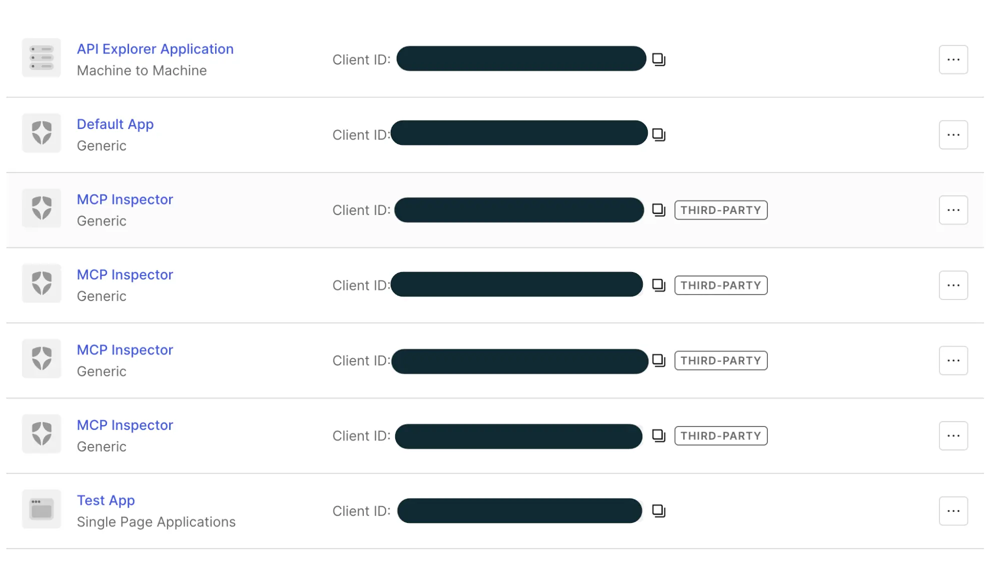

import InlineCta from "@site/src/components/InlineCta";
import heroImage from "./hero-image.webp";
import OidcTopology from "../2025-12-16-mcp-oidc-provider/diagrams/OidcTopology";
import {
  OAuthHandshake,
  OidcDiscovery,
  DynamicRegistration,
  CimdFlow,
  RelayFlow,
} from "./diagrams";


In any service you end up having three basic problems: business logic,
authentication, and authorization. All of these end up needing to be fairly
custom for people that integrate with your service. This custom integration pain
is especially apparent with MCP servers, and it results in a lot of strange
workarounds that pile up into a lot of hacks. Yet MCP is fairly universal and
the authentication is (mostly) painless. How do these two things add up?

When we implemented our
[hosted MCP server](https://www.tigrisdata.com/docs/mcp/) we ended up with a
flow based on [OpenID Connect](https://openid.net/developers/how-connect-works/)
(OIDC). OIDC is built on top of the industry standard
[OAuth 2](https://oauth.net/2/), but it adds opinionated discovery and schemata
that make integration painless. With vanilla OAuth 2 you end up having to write
[custom code per provider](https://pkg.go.dev/golang.org/x/oauth2#section-directories).
With OIDC you punch in a client ID, client secret, and discovery URL and then
you're done. Add dynamic client registration on top and MCP clients can request
the credentials they need on their own, so you can get back to changing the
world via business to business software as a service programs.

:::note

I guess in the age of modern agentic engineering tools the toil involved with
custom integrations can mostly be automated, but in general not having to write
code is a lot easier than having to write code.

:::

Today we're going to learn more about OIDC, dynamic client registration, a
solution we built and later concluded was too complicated in practice, and what
we think you should actually build instead.

## OAuth 2, OIDC, and the problem of dynamic client registration

At a high level, OAuth 2 requires your application to have a few things set up:

- A callback URL for the application to confirm sessions
- A client ID (public)
- A client secret (private)
- Provider specific logic for fetching user information at the end

This ends up going through a flow something like this:

<OAuthHandshake />

So you have your service request an OAuth 2 session with the identity provider
and get an access token (and maybe a refresh token) back. Then what do you do?
This is where the pile of provider specific logic comes into play, because every
service provider has their own HTTP route and schema for telling you who the
user is. GitHub wants you to call `/user`, Google has its own endpoint, and
every one of them returns a slightly different shape of JSON. The big thing OIDC
provides is common HTTP discovery and schema mappings, so you don't have to
implement everything in a provider specific manner.

OIDC also standardizes ID tokens as
[JSON Web Tokens](https://www.jwt.io/introduction#what-is-json-web-token)
(JWTs). JWTs are a known quantity in computing. I'm personally not the biggest
fan of them for many reasons that
[people much smarter than me can opine on in detail](https://paragonie.com/blog/2017/03/jwt-json-web-tokens-is-bad-standard-that-everyone-should-avoid),
but they're widely used enough to be considered a boring choice. Every route is
a JSON endpoint over HTTP and every response format is standardized. You can't
make the responses better fit your own identity model, but every client in the
world can read them. The
[discovery document](https://openid.net/specs/openid-connect-discovery-1_0.html)
at `/.well-known/openid-configuration` tells a client where everything lives:

<OidcDiscovery />

Overall this means that integrating with an OIDC service requires you to have a
few things set up:

- A callback URL for the application to confirm sessions
- A client ID (public)
- A client secret (private)
- The provider's OIDC discovery endpoint to figure out where to send traffic

But how do you get that client ID and client secret? That's where things get
"fun". Normally you have to clickops your way through a dashboard for this.

### Why we need dynamic client registration

In site reliability there are three numbers: one, many, and infinity. Normally
when dealing with OIDC clients you have many of them. With MCP servers, every
MCP client needs to have its own credentials to a target service, so you end up
with something close to infinity of them. With numbers like infinity in play,
you absolutely cannot tolerate making people clickops their way through getting
a client ID and client secret. You need clients to be able to register
themselves dynamically, even without a valid authentication session at first.

Open registration like this is older than MCP by a long shot.
[OpenID Connect Dynamic Client Registration](https://openid.net/specs/openid-connect-registration-1_0.html)
was finalized in 2014, and
[RFC 7591](https://www.rfc-editor.org/rfc/rfc7591.html) generalized it to all
OAuth 2 identity providers in 2015. The place most people have actually seen it
is [Mastodon](https://docs.joinmastodon.org/methods/apps/) (a federated short
post social network service, much like Twitter used to be). Any client can call
`POST /api/v1/apps` on any Mastodon server without logging in first. You send a
name and your redirect URIs, you get back a client ID and client secret, and
then your user can authenticate and get tooting the night away. Fediverse
clients have done this since Mastodon launched in 2016, and it works fairly
well.

The overall RFC 7591 flow looks like this:

<DynamicRegistration />

This means that your MCP client, Mastodon client, or whatever kind of client you
are dreaming up can just dynamically request the OAuth 2 information it needs to
get the job done and move on with life. The
[March 2025 revision of the MCP spec](https://modelcontextprotocol.io/specification/2025-03-26/basic/authorization)
told servers that they should support it, and most of the ecosystem did. Overall
the user experience for this is pretty great. You punch in that you want to set
up the Tigris MCP server at `https://mcp.storage.dev/mcp` and then you
authenticate and get back to making your dreams come true.

Your provider probably had a fairly terrible UI / UX for this though. In Auth0,
[every application created through dynamic client registration](https://auth0.com/docs/get-started/applications/dynamic-client-registration)
is a third-party application. Each one landed in the same list as our own
applications, so every customer added one entry for Claude, another for Cursor,
another for Codex, and another every time they set things up again:



This level of administrative toil makes you want to build your own man in the
middle OIDC provider that just handles the weirdness for you and shows up in
Auth0 as a single entry: the Tigris MCP server.

## So we did that with mcp-oidc-provider

Last December we released
[mcp-oidc-provider](https://www.tigrisdata.com/blog/mcp-oidc-provider/), a
library that implements that man in the middle OIDC provider as an Express
route. It sits between your identity provider and your users, handles dynamic
registration, and only lets users through if your upstream allowed them through.
We used it to power [our MCP server](https://www.tigrisdata.com/docs/mcp/). This
turns the OAuth 2 three way handshake into a four way handshake:

<div className="mermaid-frame">
  <OidcTopology label="FIG 04" title="where mcp-oidc-provider sat" />
</div>

It did everything we needed, but it had a bit of technical overhead that came
back to bite us: we ended up building an entire OIDC server. mcp-oidc-provider
kept a session with the upstream provider and then minted its own JWTs for
clients, signed with its own keys. Logging in to the MCP server meant you
authenticated with mcp-oidc-provider, which sent you to authenticate with Auth0,
and then the callbacks chained all the way back to your client. It worked, but
it was kind of hacky in practice.

Worse, a server that mints tokens holds a signing key. Anyone who steals that
key can forge a valid token for any user, and the server also had to keep each
user's upstream refresh token around so it could keep their session alive. That
is a lot of very sensitive state for a component whose whole job is to make a
dashboard less cluttered.

On top of that, we overengineered the plugin surface. mcp-oidc-provider can plug
into any identity provider and any [Keyv](https://keyv.org/) storage backend you
want, even though we only ever used and tested it with Auth0 for the identity
provider and Tigris for storage.

:::note

Making an interface for Tigris have a hard dependency on Tigris seems like a
circular dependency that we should avoid, but it's actually not a problem in
practice. If Tigris is down to the point that the MCP server can't authenticate,
then the interface to Tigris is probably not as useful anyway, because Tigris is
down.

:::

## The MCP ecosystem gave us Client ID Metadata Documents

The MCP ecosystem has been evolving at machine speed. Even the overhead of
dynamic client registration turned out to be a bit too much, so the ecosystem
has given us [Client ID Metadata Documents](https://client.dev/) (CIMD). The
[November 2025 revision of the MCP spec](https://modelcontextprotocol.io/specification/2025-11-25/basic/authorization)
made CIMD the recommended way for clients to identify themselves, and the
[July 2026 revision](https://modelcontextprotocol.io/specification/2026-07-28/basic/authorization)
deprecates dynamic client registration outright. With CIMD there is no
registration step and no client secret at all. Your agent hosts a JSON metadata
document, and the URL of that document _is_ the client ID:

```json
{
  "client_id": "https://tigris.dev/oauth/metadata.json",
  "client_name": "Tigris Agent Cloud",
  "client_uri": "https://tigris.dev",
  "logo_uri": "https://tigris.dev/logo.png",
  "redirect_uris": ["https://tigris.dev/oauth/callback"]
}
```

If you hosted this at `https://tigris.dev/oauth/metadata.json`, you'd pass it in
an OAuth 2 call like this:

```text
GET /authorize?client_id=https://tigris.dev/oauth/metadata.json&...
```

Then the server fetches that metadata document and makes sure it makes sense:
the `client_id` inside has to match the URL it came from exactly, and the
redirect URI in the request has to be on the list. It picks up the name and logo
for the consent screen, and then it does the rest of the authentication session
for you. The client proves it's the one that started the login with
[PKCE](https://www.rfc-editor.org/rfc/rfc7636) instead of a client secret.

<CimdFlow />

This solves nearly all of the problems that dynamic client registration has in
practice because it removes the need for clients to register in the first place.
Nothing gets created in your identity provider, so there is nothing to clean up.
Even Auth0 supports it now: CIMD shipped as part of
[Auth0's Auth for MCP](https://auth0.com/blog/auth0-auth-for-mcp-servers-generally-available/)
in May 2026.

Keep in mind that your auth server is now making HTTP requests to URLs that
strangers hand it. The
[CIMD draft](https://datatracker.ietf.org/doc/draft-ietf-oauth-client-id-metadata-document/)
says servers must not follow redirects or fetch special-use IP addresses, so
treat that fetcher with the same suspicion you'd give any other SSRF magnet.

The only real downside is that it's too new for many clients to support. Claude,
ChatGPT, and Zed speak CIMD today, VS Code has partial support, and plenty of
others are still unknown according to
[Zuplo's MCP client compatibility matrix](https://zuplo.com/learn/mcp/compatibility).
Cursor has it as
[a feature request on their forum](https://forum.cursor.com/t/mcp-oauth-cimd-support-plans-and-timelines/148096),
and as of their last staff reply in May 2026 they don't have a timeline to
share. Once it's more widely supported I'm sure it will be pretty great for
everyone!

## Friendship ended with mcp-oidc-provider, now CIMD is my new best friend

:::danger[FACT CHECK: remove before publishing]

Research found no CIMD code on `tigrisdata/mcp` main as of 2026-11-12. CIMD only
exists in mcp-oidc-provider PR #49 and TIG-9963 (In Progress). Confirm CIMD is
live on mcp.storage.dev before publishing, or soften "mostly moved over to
CIMD".

:::

In our testing and daily use, we've found that CIMD is so useful that we've
discontinued our own use of mcp-oidc-provider and mostly moved over to CIMD.
We're going to archive the
[mcp-oidc-provider](https://github.com/tigrisdata/mcp-oidc-provider) repository
soon and mark it as unmaintained on npm. If you need mcp-oidc-provider for your
own use cases, please fork it and maintain your own copy. In this modern age of
[a new major CVE every few days](https://epoch.ai/data/cve?view=graph) we think
it's fairly irresponsible to even hint that we are actively maintaining
something we're not satisfied with using for ourselves. Security critical code
that nobody is watching attracts exactly the wrong kind of attention.

For clients that can't use CIMD yet (EG: Cursor), our MCP server now handles
dynamic client registration itself with a thin relay in front of Auth0. A
registration is a row in our own storage, and nothing is created in Auth0. From
Auth0's point of view the MCP server is one regular web application with one
callback URL. Logins and token requests pass through to Auth0 with the client's
own PKCE challenge, and the tokens Auth0 mints go straight back to the client:

<RelayFlow />

Because Auth0 mints every token, the MCP server doesn't hold a signing key and
doesn't keep sessions. It checks incoming tokens against Auth0's public keys
like any other resource server would. The thing we have to protect went from "a
key that can impersonate anyone" to "a list of registrations and some
short-lived login state". This works well enough in practice that we kinda
honestly wish we had thought of it back in the day.

If you're about to build your own OIDC server to make MCP authentication behave,
don't. Support CIMD, and if you need to serve DCR-only clients in the meantime,
relay to your identity provider instead of becoming one.

<InlineCta
  title="Connect your agent to Tigris"
  subtitle="The Tigris MCP server lets Claude, ChatGPT, Cursor, and other MCP clients work with your buckets and objects. Add it with one URL and log in."
  button="Read the MCP server docs"
  link="https://www.tigrisdata.com/docs/mcp/"
/>
