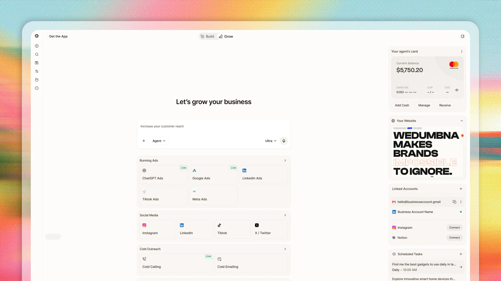

import InlineCta from "@site/src/components/InlineCta";
import BreakoutQuote from "@site/src/components/BreakoutQuote";
import AppInitArchitecture from "./diagrams/AppInitArchitecture";
import sakshamSarda from "./saksham-sarda.webp";

What do you do when an AI agent builds a thousand apps a day, and each one needs
somewhere to keep its files?

[Runable](https://runable.com) is an AI agent for people who would rather not
touch code. Most of its more than 2 million registered users run small
businesses: a bakery that wants online orders, a coach who needs a booking app,
a shop that wants a website by this afternoon. They describe what they want and
Runable builds it, whether that's a website, a mobile app, a slide deck or an ad
campaign.

For apps, that includes the backend. Every app Runable builds gets its own
Tigris bucket and an access key that works on that bucket and nowhere else.

{/* truncate */}

## Every app gets a backend of its own

A website can be a folder of static files, but an app needs more. Once a user
says "let customers upload a photo" or "take payments," the app needs a
database, file storage, payments and sign-in, and someone has to set all of it
up.

On Runable, the agent does that with one tool call. The call creates the
database, the bucket, the access key, payments and the AI gateway config in
parallel, then puts the credentials in the app's environment. The whole step
takes 10.8 seconds at the median, and the agent goes back to writing features.

  <AppInitArchitecture />

## A key that stops at one bucket

An agent writes the code in these apps, and a small business owns it without
ever reading it. Runable wouldn't let isolation between apps depend on that code
being right. Each app gets its own bucket, plus a key with the Editor role on
that bucket and nothing else. If one app leaks its key, the damage stops at that
app's files.

<BreakoutQuote
  username="Saksham Sarda"
  title="Co-founder and CTO, Runable"
  imageUrl={sakshamSarda}
>
  Our users don't read the code the agent writes, so isolation has to be built
  into the platform. One bucket per app and one key per bucket means a change in
  one app stays in that app.
</BreakoutQuote>

The people who use those apps never see the bucket. They upload avatars, product
photos and documents straight to Tigris through presigned URLs, and the app
serves them back. When a Runable user copies an app to try a new direction, the
copy gets a fresh bucket and key of its own.

## Planning for a thousand apps a day

As apps on Runable took off, the team planned storage for where growth was
heading: thousands of new apps a day, each with its own bucket and its own
scoped key. Minting a key had to be as routine as creating the bucket, with no
account-level ceiling to plan around.

The team weighed the usual shortcuts. Shared keys, or many apps in one bucket,
would weaken the isolation. A fleet of storage accounts would turn key
management into a job of its own. Runable wanted storage that was built for one
bucket and one key per tenant from the start.

"Our users build a thousand apps a day, and every one gets its own key," says
Saksham. "We wanted storage where minting a scoped key is as routine as creating
the bucket, so we never have to think about it."

## A 336-line switch

Runable joined a shared Slack channel with Tigris, and Saksham asked what anyone
asks before moving storage. Is it really S3-compatible? What does migration look
like? Will the pricing hold once we depend on it? The answers, with docs links,
were there the next morning.

The switch itself was one module. Ankit, on the Runable team, replaced the old
provider's code with a Tigris version that creates the bucket, sets CORS so
browsers can upload to presigned URLs, and mints a key with `role: "Editor"` on
that one bucket. The apps didn't change. They still speak S3, with a new
endpoint and new keys.

The pull request added 336 lines, removed 92, and merged 32 minutes after it
opened. A week later it was serving production, less than two weeks after
Saksham's first questions.

## Results

Between July 24 and November 2, Runable ran 65,841 app setups on Tigris.

| Measure                                            | Result          |
| -------------------------------------------------- | --------------- |
| Setups that finished the storage step on first try | 99.9% of 65,841 |
| Full app setup, median (October)                   | 10.8 s          |
| Full app setup, p90 (October)                      | 13.2 s          |

The setup times cover all five resources, with the bucket created in parallel
with the rest.

## More of Runable on Tigris

The next version of Runable puts the platform's own files on Tigris too. A
global bucket will hold users' attachments, artifacts, skills and voices,
managed with Tigris's Pulumi provider.

The bakery owner asking for online orders won't hear about any of it. Their app
will have a bucket that no other app's key can open, created in the ten or so
seconds before the agent starts on features.

<InlineCta
  title="Give every tenant its own bucket"
  subtitle="Create buckets and scoped access keys on demand, with no egress fees. Your apps keep speaking S3."
  button="Create a bucket"
/>
